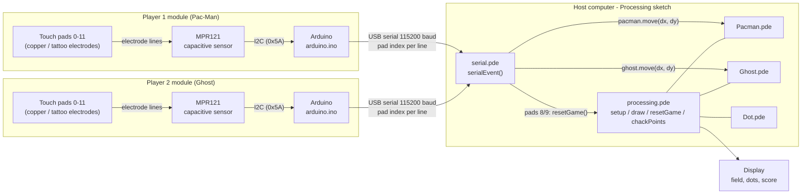

# Architecture

Two-player Pac-Man game controlled by capacitive touch pads (wearable tattoo electrodes).

## Firmware (`firmware/arduino/arduino.ino`)

1. On startup, restart MPR121 sensing and average 20 readings per pad as a software baseline.
2. Every 10 ms, read the chip touch flags and filtered data for all 12 electrodes.
3. A pad counts as touched if the chip reports it, or its reading drops more than 5 below baseline.
4. On a new touch (rising edge), print the pad index as one line over serial.

## Host (`processing/`)

| File | Role |
|---|---|
| `serial.pde` | Opens one serial port per player; validates numeric lines and maps pad to action |
| `processing.pde` | Game state, draw loop, dot spawning, scoring, reset |
| `Pacman.pde` | Player 1 character; bounded movement and facing angle |
| `Ghost.pde` | Player 2 character; bounded movement |
| `Dot.pde` | Dot position |

## Pad mapping

| Pad | Action |
|---|---|
| 0 | Up (dy = -10) |
| 1 | Down (dy = +10) |
| 2 | Left (dx = -10) |
| 3 | Right (dx = +10) |
| 8, 9 | Reset game |

The serial port a line arrives on decides whether it moves Pac-Man or the ghost.
